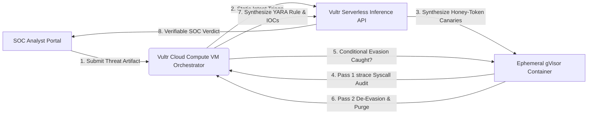

# 🛡️ DETONATE — Autonomous Zero-Blast-Radius SOC Sandbox on Vultr

**Built for the Vultr: Agent Rush Hackathon (Challenge 1: Blast Radius Zero)**

**Detonate** is an enterprise-grade autonomous security orchestration platform that safely detonates untrusted software artifacts—such as obfuscated Bash droppers, compromised `npm` package postinstall hooks, and poisoned CI/CD pipelines—inside ephemeral, high-security **gVisor (`runsc`)** user-space kernel sandboxes running on **Vultr Cloud Compute**, powered by **Vultr Serverless Inference**.

---

## 🏗️ Architecture & Autonomous Agent Workflow



### How Vultr Powers Detonate

1. **Vultr Cloud Compute (Central Control Plane):** Hosts the production Next.js application, Docker container daemon, and `gVisor` (`runsc`) user-space Sentry kernel runtime.

2. **Vultr Serverless Inference (`https://api.vultrinference.com/v1`):** Drives the multi-step agentic reasoning pipeline:
   - **Canary Arming:** Analyzes untrusted scripts and provisions realistic decoy honey-tokens (`/workspace/.env` and `~/.aws/credentials`) inside the execution workspace.
   - **Adaptive De-Evasion:** Evaluates Pass 1 telemetry; if malware enters a dormant state upon detecting standard sandbox flags, the agent automatically injects runner environment telemetry and re-detonates.
   - **Threat Synthesis:** Translates raw kernel syscall logs (`connect()`, `openat()`, `execve()`) into an executive SOC report and an exportable YARA detection rule.

---

## 🔒 Four-Pillar Containment Model (Blast Radius: ZERO)

Every detonation executes inside a strictly governed container enforcing four non-negotiable security guardrails:

- **User-Space Kernel Virtualization:** Executed under `--runtime=runsc` (**gVisor**), intercepting syscalls so malicious payloads never interact directly with the host Linux kernel.
- **Secret Hygiene & Network Isolation:** `--network none` physically blocks all outbound data exfiltration attempts while `strace` audits attempted C2 socket connections (`ENETUNREACH`).
- **Resource Hardening:** Enforces strict execution limits (`--memory 128m`, `--cpus 0.5`, `--pids-limit 32`, and an 8-second execution timeout) to neutralize fork bombs and resource exhaustion attacks.
- **Lifecycle Discipline:** Backed by `--rm` and ephemeral volume teardown (`shutil.rmtree`), ensuring zero state or malicious remnants persist after execution.

---

## 🚀 Quick Start & Deployment

### 1. Clone the Repository

```bash
git clone https://github.com/SyedAhmedAliRaza/Detonate.git
cd Detonate/detonate-web
```

### 2. Build the Sandbox Docker Image

```bash
docker build -t detonate-sandbox:latest -f Dockerfile.sandbox .
```

### 3. Install Dependencies

```bash
npm install
```

### 4. Build the Application

```bash
npm run build
```

### 5. Start the Application

```bash
npm run start
```
